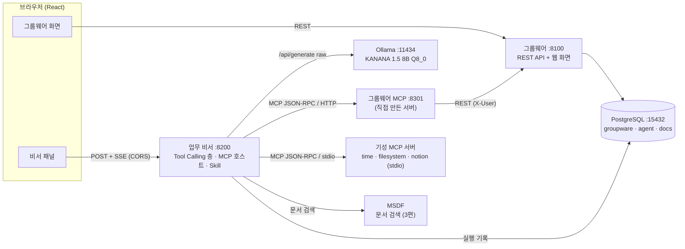

# 구조

3편에서는 Agent·도구·그룹웨어 호출이 한 파이썬 프로세스 안의 함수 호출이었다. 4편은 각자 떠 있는 서버들이 서로 부른다.



## 서비스와 포트

| 서비스 | 포트 | 실행 | 하는 일 |
|---|---|---|---|
| PostgreSQL + pgvector | 15432 | `docker compose -f infra/docker-compose.yml up -d` | 그룹웨어 데이터, 비서 실행 기록 |
| Adminer | 8081 | (위와 함께) | DB 관리 화면 |
| Ollama | 11434 | `ollama serve` | 모델 서빙 |
| 그룹웨어 | 8100 | `uvicorn infra.groupware.app:app --port 8100` | 메일·일정·결재 API, React 화면(`web/dist`) |
| 업무 비서 | 8200 | `uvicorn chat_ui.server:app --port 8200` | 비서 패널이 부르는 서버, 3편 챗봇(`/chat`) |
| 그룹웨어 MCP | 8301 | `python -m chat_ui.mcp_servers.groupware` | 그룹웨어 도구 10개를 MCP로 |
| 웹 개발 서버 | 5173 | `cd web; npm run dev` | (개발할 때만) `/api`를 8100으로 넘긴다 |

PostgreSQL 포트가 15432인 것은 이 실습 PC의 5432~5434를 다른 PostgreSQL이 쓰고 있어서다. 바꾸려면 `infra/docker-compose.yml`과 `GROUPWARE_DSN`/`AGENT_DSN`을 같이 바꾼다.

## 통신 경로

| # | 누가 → 누구 | 방식 | 무엇 | 장 |
|---|---|---|---|---|
| ① | 브라우저 → 비서 | HTTP POST, 진행은 SSE(또는 폴링) | 질문, 실행 과정, 승인 | 4 |
| ② | 비서 → 모델 | Ollama `/api/generate`, raw 모드 | 우리가 렌더링한 프롬프트 글자 → 모델이 쓴 글자 | 1 |
| ③ | 비서 → 기성 MCP 서버 | MCP, stdio(자식 프로세스) | `tools/list`, `tools/call` | 2 |
| ④ | 비서 → 그룹웨어 MCP | MCP, Streamable HTTP + 서비스 키 + 사용자 `_meta` | 그룹웨어 도구 | 3 |
| ⑤ | 그룹웨어 MCP → 그룹웨어 | REST, `X-User` | 실제 데이터 | 3 |
| ⑥ | 그룹웨어 → (구독자) | `outbox_events` + `NOTIFY`, webhook | 변경 이벤트 | 4 |

비서는 그룹웨어 DB를 직접 읽지 않는다. DB 계정을 나눠 두었다(`assistant` 계정은 `groupware` 스키마 권한이 없다). 그룹웨어 데이터는 MCP 서버 → REST를 거친다.

## 폴더

```
chat_ui/                 업무 비서 서버
  server.py              API·SSE (FastAPI)
  runner.py              실행(작업) 관리, 3편 실습 목록, 업무 비서 실행
  agent/
    toolcall.py          Tool Calling 층
    assistant.py         업무 비서 (도구 구성, 시스템 프롬프트)
    mcp_host.py          MCP 호스트
    servers.yaml         붙일 MCP 서버 목록
    skills.py            Skill 불러오기
    runlog.py            실행 기록 → PostgreSQL agent 스키마
  mcp_servers/groupware/ 그룹웨어 MCP 서버
  skills/                Skill 파일 (SKILL.md)
  static/chat.html       3편 챗봇 화면
web/                     React 화면 (그룹웨어 + 비서 패널)
infra/
  docker-compose.yml     PostgreSQL + pgvector, Adminer
  db/                    DB 계정 초기화, 마이그레이션 SQL
  groupware/             그룹웨어 서버, 샘플 데이터
  msdf/                  MSDF DAG·서비스 (3편 데이터 준비)
common/                  3편 공용 코드 (LLM 연결, 도구, 보고서 저장 …)
s1_single … s4_graph/    3편 실습 (Single → Workflow → Multi → Graph)
steps/                   4편 실습 스크립트, 시나리오
serving/                 Ollama Modelfile, KANANA chat template
tools/                   모델 도구 호출 확인
tests/                   pytest (가짜 모델, GPU 없이)
```
